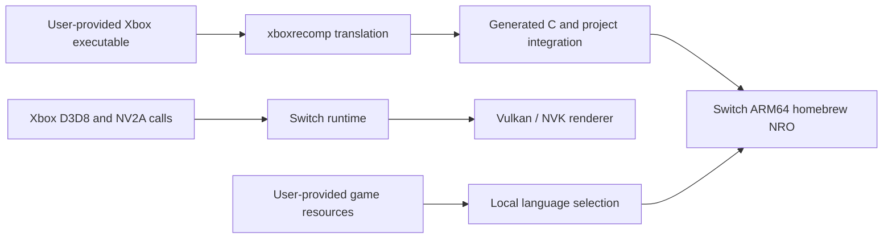

<div align="center">


# Second Sight on Nintendo Switch

### An experimental Xbox static-recompilation project


**A homebrew research project. No game executable or playable resources are included.**

[English](README.md) · [Русский](README.ru.md) · [Acknowledgements & tools](ACKNOWLEDGEMENTS.md)

</div>

> **Artwork:** The project owner supplied the banner and confirmed it may be included in this repository.

---

## 📋 At a glance

| | |
|---|---|
| **Original game** | *Second Sight*, Xbox version |
| **Target** | Nintendo Switch homebrew |
| **Method** | Static recompilation of the Xbox executable, with Switch-specific runtime services |
| **Graphics path** | Xbox D3D8/NV2A behavior translated through the project runtime to Vulkan/NVK |
| **Current stage** | Early gameplay runs on hardware; compatibility and performance work continues |
| **License** | MIT for project-authored code and documentation; third-party works and game materials are excluded. See [LICENSE](LICENSE) and [licensing notes](docs/LICENSING.md) |

## ⚡ Quick build

These commands describe the **current developer workspace**, not a clean GitHub checkout. The detailed guide lists its external dependencies, local game-file requirements, and current reproducibility limits: [`docs/BUILDING.md`](docs/BUILDING.md).

If the generated guest code is missing, run in PowerShell from the workspace root:

```powershell
.\porting\switch\regen.ps1
```

Then run in the devkitPro MSYS2 shell from that same root:

```bash
bash porting/switch/tools/build_r13k.sh
```

The script stages the NRO under `porting/switch/switch_sd/`. It requires the local XBE, generated code, runtime, Vulkan SDK pieces, and Switch toolchain; those are not included in this repository.

## 🧩 What this project is

The goal is to make the Xbox version of *Second Sight* run as a homebrew application on Nintendo Switch. The Xbox executable is translated ahead of time into C, then built for the Switch CPU. A platform runtime provides the Xbox services the game expects and translates its graphics work for the Switch.

This is **not** a packaged Xbox emulator. It is also not a finished port: the executable can reach gameplay, but some scenes still have rendering and performance problems, and full-game completion has not been verified.



## 📊 Current status

The status below separates what has been observed on the console from work that still needs a hardware run.

| Area | Status |
|---|---|
| Launch and menus | Reached on Switch hardware |
| Profiles and controller input | Profile creation and gameplay controls observed working |
| Audio | Menu and gameplay audio/music observed; opening-video audio remains intermittent |
| Early gameplay | Playable sections observed; telekinesis and tutorial prompts appeared in tested builds |
| Shadows | Improved after fixing cropped render-target views; looked correct in one tested location, but wider scene coverage is incomplete |
| Russian resources | Extracted locally and language selector built in r13k; **not yet verified on the console** |
| Full-game compatibility | Not established; not every mission, cutscene, save path, or ending has been checked |
| Performance | Near 60 FPS in some interiors was reported; heavy outdoor scenes can drop substantially below the target |

The last build confirmed by the user on hardware was **r13j**. **r13k** adds the language selector and a texture-cache correction, but has not yet received the same on-console confirmation. Build success alone does not establish game compatibility or a performance gain.

## ⚠️ Known issues

These are reported observations, not claims that every issue happens in every run:

- Brief surface or texture flicker can appear while moving or turning the camera.
- Some later cutscenes have shown large blocks or other visual artifacts.
- The first two opening movies have been reported with missing video and interrupted audio.
- Large outdoor scenes with many NPCs or vehicles can have severe frame-rate drops. A stable 60 FPS across the whole game has **not** been achieved or demonstrated.
- A freeze at the beginning of a sniper mission was reported on an earlier build; its status on the current build is unknown.

Use the repository Issues page for confirmed, reproducible reports. Include the build ID, mission/scene, steps to reproduce, and a short log excerpt. Do not attach game data, save files, or full reverse-engineering databases.

## 🌐 Language selection

The local launcher reads:

```text
sdmc:/switch/secondsight/language.txt
```

Set the file contents to `en` or `ru`, then fully close and relaunch the NRO. The same executable is used for both languages; the setting chooses the matching local resource folder. Save data is shared between the language settings.

The current configuration falls back to English if Russian assets are missing or incomplete. The Russian resource tree is large and remains on the user's own storage; it is not part of this repository. The r13k selector still needs a hardware check before this can be described as a verified feature.

## 🏗️ Building from a clean checkout

There is no release NRO yet. The current build depends on local folders and revisions that are not part of this repository, so a clean clone is not buildable yet. The short commands above are for the existing developer workspace. [`docs/BUILDING.md`](docs/BUILDING.md) records the full current process and the work needed to make it reproducible. No ISO, XBE, extracted playable resource, generated game implementation, or compiled NRO is distributed here.

## 🙏 Design references and acknowledgements

This project stands on the work of the Xbox recompilation and Switch homebrew communities. We studied related ports and adapted a small number of techniques only after comparing them with Second Sight's own runtime and checking their behavior on the target hardware.

In particular, the [FlatOut 2 Switch port](https://github.com/antoxa2584x/flatout2-sw) informed several individually adapted renderer changes: GPU unpacking for packed vertex data, a snapshot for valid render-target feedback, and a lower-copy texture upload path. This does **not** mean that the whole FlatOut 2 runtime or its game-specific code was copied.

Other projects, including [mksm-switch](https://github.com/gerisson1996/mksm-switch), [NFS Underground 2 Switch](https://github.com/antoxa2584x/nfsu2-sw), [TimeSplitters: Future Perfect recompilation](https://github.com/NeilSeligmann/tsfp-recomp), and [Split/Second recompilation](https://github.com/phobos665/split2-recomp), were reviewed for architecture, runtime behavior, and debugging approaches. Their title-specific addresses and game logic are not used as Second Sight replacements.

### 🧰 Tools used

- **xboxrecomp** — translates Xbox guest code for the native build.
- **Ghidra** with the [Ghidra XBE loader](https://github.com/XboxDev/ghidra-xbe) — examines the Xbox executable and its code/data references.
- **GhidraMCP** and **REA MCP** — assist with analysis and evidence gathering. REA's direct XBE load was unsupported in the recorded session, so XBE findings were checked using Ghidra and the original executable.
- **devkitPro, devkitA64, libnx, CMake, Ninja, and MSYS2** — build the Switch homebrew application.
- **GitHub MCP and GitHub source history** — inspect upstream projects and revisions.

The full source list, roles, pinned revisions, and attribution boundaries are in [`ACKNOWLEDGEMENTS.md`](ACKNOWLEDGEMENTS.md). Third-party runtimes are not vendored; review their upstream licensing before redistributing them.

## 🗺️ Roadmap

- [ ] Verify the English/Russian selector on Switch and document the complete user-owned file layout.
- [ ] Make the build reproducible from a clean checkout with pinned dependencies.
- [ ] Fix and retest the opening videos and cutscenes.
- [ ] Track down movement-related texture flicker and remaining scene artifacts.
- [ ] Profile heavy outdoor scenes and improve frame rate without relying on overclocking.
- [ ] Play through all missions and record compatibility by scene.

## 🤝 Contributing

Useful reports describe one issue at a time and include:

- the NRO build ID;
- the mission and exact location;
- steps to reproduce and whether the issue is repeatable;
- what changed compared with the previous build;
- a concise log excerpt or a photo/video of the issue.

Please do not submit copyrighted game files, extracted assets, save data, or local Ghidra/REA databases.

## 📜 License and game content

Project-authored code and documentation are licensed under the MIT License in [`LICENSE`](LICENSE). Third-party code remains under its own terms; see [`docs/LICENSING.md`](docs/LICENSING.md) and the separate notices in [`licenses/`](licenses/). The MIT license does not grant rights to *Second Sight*, its game assets, trademarks, or the supplied header artwork; permission for the artwork is separate.

*Second Sight* and related names are used to identify the game being researched. This independent homebrew project is not affiliated with or endorsed by the game's rights holders. You must supply your own game files; this repository will not host them. The header artwork was supplied by the project owner with permission for public inclusion. It is not covered by the project's MIT license.

---

<div align="center">

**Experimental homebrew project · No game executable or playable resources included · Hardware results are reported separately from build results**

</div>

