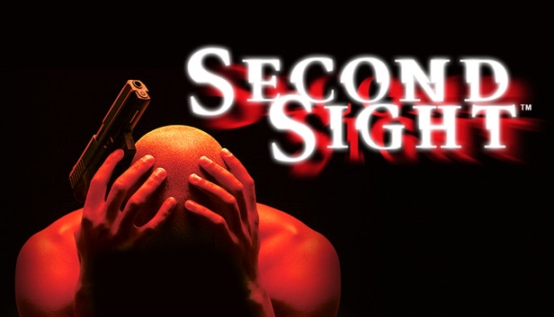
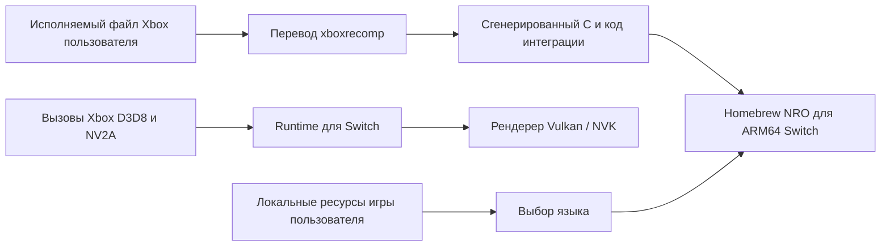

<div align="center">



# Second Sight на Nintendo Switch

### Экспериментальный проект статической рекомпиляции Xbox-версии


**Домашний проект для исследований. Исполняемый файл игры и игровые ресурсы не включены.**

[English](README.md) · [Русский](README.ru.md) · [Благодарности и инструменты](ACKNOWLEDGEMENTS.md)

</div>

> **Иллюстрация:** Изображение для шапки предоставлено владельцем проекта; подтверждено разрешение на его публичное использование в этом репозитории.

---

## 📋 Кратко о проекте

| | |
|---|---|
| **Исходная игра** | *Second Sight*, версия для Xbox |
| **Целевая платформа** | Nintendo Switch homebrew |
| **Подход** | Статическая рекомпиляция исполняемого файла Xbox и системный слой для Switch |
| **Графика** | Поведение Xbox D3D8/NV2A преобразуется runtime-слоем в Vulkan/NVK |
| **Текущий этап** | На консоли запускается игровой процесс; продолжается работа над совместимостью и скоростью |
| **Лицензия** | MIT для кода и документации проекта; сторонние работы и материалы игры исключены. См. [LICENSE](LICENSE) и [заметки о лицензировании](docs/LICENSING.md) |

## ⚡ Быстрая сборка

Эти команды описывают **текущую рабочую папку разработчика**, а не чистую копию с GitHub. Полное руководство перечисляет внешние зависимости, локальные файлы игры и текущие ограничения воспроизводимости: [`docs/BUILDING.md`](docs/BUILDING.md).

Если сгенерированного гостевого кода ещё нет, выполните в PowerShell из корня рабочей папки:

```powershell
.\porting\switch\regen.ps1
```

Затем в оболочке devkitPro MSYS2 из того же корня выполните:

```bash
bash porting/switch/tools/build_r13k.sh
```

Скрипт помещает NRO в `porting/switch/switch_sd/`. Для сборки нужны локальный XBE, сгенерированный код, runtime, части Vulkan SDK и Switch toolchain; они не входят в репозиторий.

## 🧩 Что это за проект

Цель — запускать Xbox-версию *Second Sight* как homebrew-приложение на Nintendo Switch. Исполняемый файл Xbox заранее переводится в C и собирается для процессора Switch. Runtime предоставляет ожидаемые игрой системные функции Xbox и переводит её графические команды для Switch.

Это **не упакованный эмулятор Xbox** и пока не готовый порт: игра доходит до игровых уровней, но в некоторых сценах ещё есть проблемы с графикой и производительностью, а прохождение всей игры не подтверждено.



## 📊 Текущее состояние

Здесь отдельно отмечено, что наблюдалось на консоли, а что ещё ожидает проверки.

| Область | Статус |
|---|---|
| Запуск и меню | Запускались на Switch |
| Профиль и управление | Создание профиля и игровое управление проверены |
| Звук | Звук и музыка в меню и игре работали; звук начальных видеороликов прерывается |
| Начальные игровые сцены | Игровой процесс запускался; телекинез и подсказки обучения появлялись в проверенных сборках |
| Тени | Исправление представлений обрезанных render target улучшило тени в проверенной сцене; остальные сцены проверены не полностью |
| Русские ресурсы | Извлечены локально; переключатель добавлен в r13k, но **на консоли не проверен** |
| Совместимость всей игры | Не подтверждена: не проверены все миссии, ролики, сохранения и концовка |
| Производительность | В некоторых помещениях пользователь видел почти 60 FPS; в тяжёлых открытых сценах бывают сильные просадки |

Последняя сборка, подтверждённая пользователем на консоли, — **r13j**. В **r13k** добавлен выбор языка и исправление кэша текстур, но эта сборка ещё не получила такой же проверки на Switch. Успешная компиляция сама по себе не подтверждает совместимость игры или прирост скорости.

## ⚠️ Известные проблемы

Это сообщения о наблюдавшемся поведении; проблема может проявляться не в каждом запуске:

- При движении или повороте камеры иногда на короткое время мерцают поверхности и текстуры.
- В некоторых более поздних катсценах появлялись крупные блоки и другие графические артефакты.
- Для первых двух начальных роликов сообщалось об отсутствии изображения и прерывистом звуке.
- В больших открытых сценах с множеством NPC или машин частота кадров заметно падает. Стабильные 60 FPS во всей игре **не достигнуты и не подтверждены**.
- В одной из предыдущих сборок сообщалось о зависании в начале снайперской миссии; на текущей сборке это место не проверено.

В Issues репозитория оформляйте отдельное сообщение на каждую подтверждённую и воспроизводимую проблему. Указывайте ID сборки, миссию, шаги воспроизведения и небольшой фрагмент лога. Не прикладывайте файлы игры, сохранения или полные базы реверс-инжиниринга.

## 🌐 Выбор языка

Лаунчер читает файл:

```text
sdmc:/switch/secondsight/language.txt
```

Запишите в него `en` или `ru`, затем полностью закройте и заново запустите NRO. Исполняемый файл один для обоих языков; настройка выбирает соответствующую локальную папку ресурсов. Сохранения общие.

Если русские ресурсы отсутствуют или неполны, текущая конфигурация переключается на английские. Папка русских ресурсов большая и остаётся на устройстве пользователя, в репозиторий она не войдёт. Переключатель r13k ещё нужно проверить на консоли, прежде чем считать его подтверждённой возможностью.

## 🏗️ Сборка из чистого checkout

Готового release NRO пока нет. Текущая сборка зависит от локальных папок и ревизий, которых нет в репозитории, поэтому чистый clone пока не собирается. Короткие команды выше относятся к рабочей папке разработчика. В [`docs/BUILDING.md`](docs/BUILDING.md) описан полный текущий процесс и работа, необходимая для воспроизводимой сборки. Образ ISO, XBE, извлечённые игровые ресурсы, сгенерированная реализация игры и готовый NRO здесь не распространяются.

## 🙏 Источники идей и благодарности

Проект опирается на работу сообщества Xbox-рекомпиляции и homebrew-портов для Switch. Мы изучали родственные проекты и адаптировали отдельные техники только после сравнения с собственным runtime Second Sight и проверки поведения на целевой консоли.

В частности, [порт FlatOut 2 для Switch](https://github.com/antoxa2584x/flatout2-sw) помог найти несколько отдельных изменений рендерера: распаковку упакованных вершин на GPU, снимок render target при корректном чтении из текущего буфера и путь загрузки текстур с меньшим числом копирований. Это **не** означает, что весь runtime FlatOut 2 или код самой игры был перенесён целиком.

Также изучались [mksm-switch](https://github.com/gerisson1996/mksm-switch), [NFS Underground 2 Switch](https://github.com/antoxa2584x/nfsu2-sw), [рекомпиляция TimeSplitters: Future Perfect](https://github.com/NeilSeligmann/tsfp-recomp) и [рекомпиляция Split/Second](https://github.com/phobos665/split2-recomp). Они помогли при сравнении архитектуры, runtime и способов отладки. Адреса и игровая логика этих проектов не подставляются вместо данных Second Sight.

### 🧰 Использованные инструменты

- **xboxrecomp** — перевод гостевого кода Xbox для сборки.
- **Ghidra** с [загрузчиком XBE](https://github.com/XboxDev/ghidra-xbe) — анализ исполняемого файла Xbox и ссылок на код и данные.
- **GhidraMCP** и **REA MCP** — вспомогательный анализ и сбор доказательств. В записанной сессии REA не смог напрямую открыть XBE, поэтому выводы по XBE проверялись через Ghidra и исходный исполняемый файл.
- **devkitPro, devkitA64, libnx, CMake, Ninja и MSYS2** — сборка homebrew-приложения для Switch.
- **GitHub MCP и история GitHub** — просмотр исходников и ревизий сторонних проектов.

Полный список источников, их роль, закреплённые ревизии и границы заимствования приведены в [`ACKNOWLEDGEMENTS.md`](ACKNOWLEDGEMENTS.md). Сторонние runtime не включены в репозиторий; перед их распространением проверьте условия upstream-лицензий.

## 🗺️ План работ

- [ ] Проверить выбор английского и русского языка на Switch и описать полную структуру пользовательских файлов.
- [ ] Сделать сборку воспроизводимой на чистой копии репозитория с закреплёнными зависимостями.
- [ ] Исправить и перепроверить начальные видеоролики и катсцены.
- [ ] Найти причину мерцания текстур при движении и оставшихся графических артефактов.
- [ ] Профилировать тяжёлые открытые сцены и повышать FPS без разгона консоли.
- [ ] Пройти все миссии и записать совместимость по сценам.

## 🤝 Как помочь

Хорошее сообщение об ошибке содержит:

- ID сборки NRO;
- миссию и точное место;
- шаги воспроизведения и повторяется ли ошибка;
- отличие от предыдущей сборки;
- небольшой фрагмент лога или фото/видео.

Не отправляйте игровые файлы, распакованные ресурсы, сохранения или частные базы Ghidra/REA.

## 📜 Лицензия и материалы игры

Код и документация, созданные для проекта, распространяются по лицензии MIT из файла [`LICENSE`](LICENSE). Сторонний код сохраняет собственные условия; подробности приведены в [`docs/LICENSING.md`](docs/LICENSING.md), а отдельные уведомления находятся в [`licenses/`](licenses/). Лицензия MIT не предоставляет прав на *Second Sight*, игровые материалы, товарные знаки или предоставленную шапку; разрешение на использование изображения предоставлено отдельно.

*Second Sight* и связанные названия используются для обозначения исследуемой игры. Этот независимый homebrew-проект не связан с правообладателями и не одобрен ими. Файлы игры пользователь предоставляет самостоятельно; репозиторий их не размещает.

---

<div align="center">

**Экспериментальный homebrew-проект · Исполняемый файл игры и игровые ресурсы не включены · Проверка сборки и проверка на консоли учитываются отдельно**

</div>

